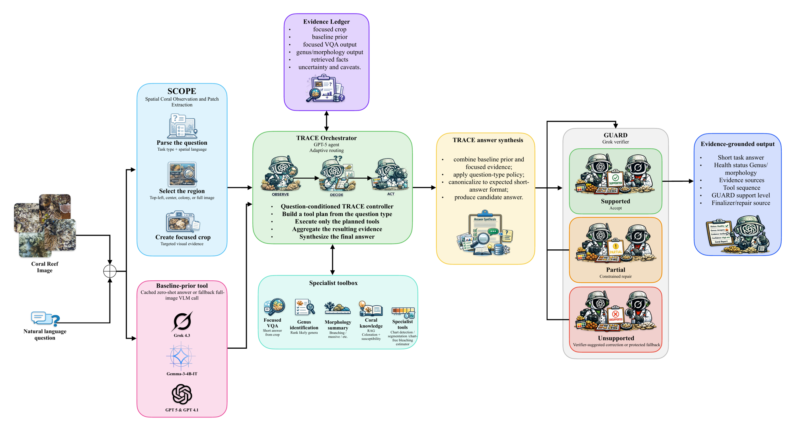
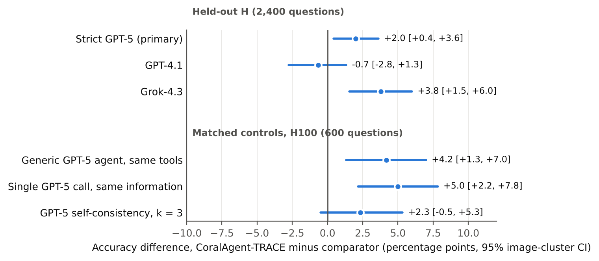
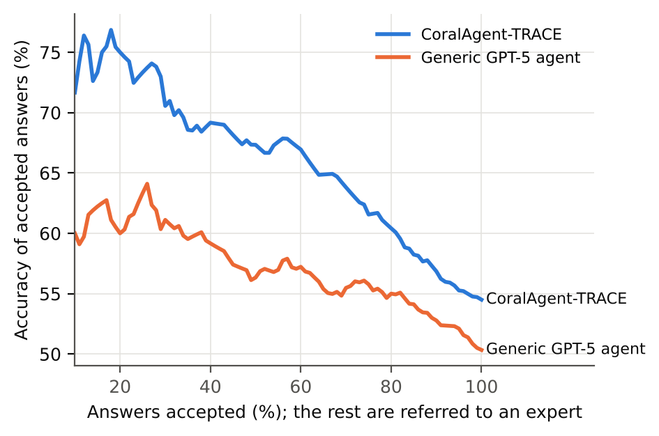

# CoralAgent-TRACE

**An evidence-grounded agentic framework for coral reef health assessment and visual question answering.**

<p>

<a href="https://huggingface.co/datasets/CoralReefData/CoralVQA"></a>
<a href="LICENSE"></a>

<a href="https://mustafanfj.github.io"></a>
</p>

CoralAgent-TRACE answers questions about coral reef images (bleaching, genus, morphology, colour, presence and cover). It uses a fixed, question-conditioned sequence of tools instead of asking one vision-language model to answer from the whole image. Every answer comes with the evidence that produced it.

> **Paper:** M. Al Juboori†, Z. Abbas† and M. Ur Rehman, "CoralAgent-TRACE: An Evidence-Grounded Agentic Framework for Coral Reef Health Assessment and Visual Question Answering," *Frontiers in Marine Science* (Coral Reef Research), under review, 2026. († equal contribution)

> **Revision (v13).** This version accompanies the revised manuscript. An audit for the first review found implementation problems in the submitted version (v12). The main one: most GPT-5 tool calls returned empty output because reasoning used up the output budget. The problems were fixed, an evaluation protocol was frozen ([PROTOCOL.md](PROTOCOL.md)), and every experiment was re-run. All results below come from v13. The submitted v12 notebook is kept unchanged as `CoralAgent_TRACE.ipynb`.



## How it works

1. **SCOPE** parses the question's spatial language and crops the region it refers to.
2. A **baseline prior** supplies a strict zero-shot GPT-5 answer. It is one piece of evidence, never ground truth.
3. **TRACE routing** chooses the tools from the requested answer type (Eq. 5 of the paper): focused VQA on the crop, genus identification, an image summary and retrieval from a curated coral knowledge base. Routing is deterministic, not open-ended planning.
4. **Answer synthesis** arbitrates between the prior and the tool evidence with fixed rules and returns a short CoralVQA-style answer.
5. **GUARD** (Grok-4.3) checks the answer against the evidence. Answers of a protected type (genus, count, colour) are only repaired when they are invalid.

## Results (v13)

CoralVQA training split, 500 images × 6 questions. The development set D is images 1–100 (600 questions); the held-out set H is images 101–500 (2,400 questions). H100 is a pre-registered random 100-image subset of H (seed 2026). Paired differences use a 95% image-cluster bootstrap CI and an exact McNemar test.

| Method | H accuracy (2,400 questions) |
|---|---:|
| **CoralAgent-TRACE (v13)** | **0.520** |
| GPT-4.1, zero-shot | 0.527 |
| GPT-5, strict zero-shot | 0.500 |
| Grok-4.3, zero-shot | 0.483 |



- **Primary, pre-registered:** TRACE beats strict GPT-5 by +2.0 points (CI +0.4 to +3.6, p = 0.011). The gain is concentrated on bleaching and health questions (0.759 vs 0.634).
- **Matched controls on H100:** TRACE beats a generic GPT-5 tool-using agent with the same tools and verifier (+4.2, Holm p = 0.018). It also beats a single GPT-5 call given the same information (+5.0, Holm p = 0.009). It is not significantly better than GPT-5 self-consistency (+2.3) or GPT-4.1.
- **Evidence:** two independent blinded LLM judges (Grok-4.3 and GPT-4.1) rate TRACE's evidence as grounded as the generic agent's. Both find that its traces expose more of its own errors (56% vs 26% and 34% vs 10% of wrong answers). Referring the least-trusted 40% of answers raises the accuracy of the rest from 0.545 to 0.669.



- **Ablations on D:** the prior with SCOPE and routing carries the gain. Retrieval has no measurable effect, and GUARD lowers accuracy slightly (removing it adds +2.8 on D and +1.3 on H).
- **Limitations:** visible-bleaching sensitivity is low (0.333 on H, specificity 0.864). The closed genus list lowers accuracy for every model, because the prompt shows only the first 90 of 392 labels. Results are limited to the CoralVQA benchmark.

The full tables are in [`analysis/`](analysis): `E2_headline.md`, `H100_controls.md`, `E3_ablations.md`, `E4_genus.md`, `E8_judge.md`, `E8b_agreement.md` and `Remaining_analyses.md`.

## Repository contents

| Path | Contents |
|---|---|
| `PROTOCOL.md` | Frozen evaluation protocol and every dated deviation |
| `coralagent/` | v13 runner: v12 core (generated from the notebook) plus fixes, batch gateway and evaluation |
| `tools/extract_v12_core.py` | Regenerates `coralagent/v12_core.py` from the v12 notebook |
| `results/v13/` | Per-question outputs for every method (compressed JSONL) |
| `analysis/` | Analysis scripts, result tables, figures, `evaluation_ids.csv` (all 3,000 question IDs and splits) and `failure_cases.json` |
| `data_release/` | The 500-image, 3,000-question evaluation bank (CoralVQA questions and references) |
| `reference/` | H100 image indices and SHA-1 hashes of the 500 images |
| `tests/` | Offline tests (no API calls) |
| `CoralAgent_TRACE.ipynb` | The submitted v12 notebook, unchanged |

## Reproducing

```bash
git clone https://github.com/mustafanfj/CoralAgent-TRACE.git
cd CoralAgent-TRACE
pip install -r requirements.txt

# Analyses and figures from the released outputs (no API keys needed)
python analysis/e2_headline.py
python analysis/h100_controls.py
python analysis/make_figures.py

# Re-running the experiments (batch APIs; costs money)
mkdir -p workdir/data/data workdir/data/outputs
cp data_release/*.csv workdir/data/outputs/
# place CoralVQA_train.jsonl from the dataset in workdir/data/data/
cp .env.example .env              # fill in OPENAI_API_KEY and XAI_API_KEY; never commit it
python -m coralagent.run setup-images      # downloads the 500 images and checks their hashes
python -m coralagent.run stage E1 --dry-run
python -m coralagent.run stage E1
```

Stages and their allowed budgets are set in `control/CONTROL.json`. Every call goes through a provider batch API, and a worst-case cost check runs before each submission. Set `CORAL_ROOT` to keep data and run state elsewhere.

**Data:** [CoralVQA](https://huggingface.co/datasets/CoralReefData/CoralVQA), training split in LLaVA format. Images are downloaded from the dataset, not redistributed. Please follow its license and citation terms.

## Citation

The paper is under review. A BibTeX entry will be added here on publication.

## License

Code released under the [MIT License](LICENSE).

## Contact

Mustafa Al Juboori, Autonomous Systems Lab, College of Computing and AI, United Arab Emirates University. [mustafanfj@gmail.com](mailto:mustafanfj@gmail.com)
