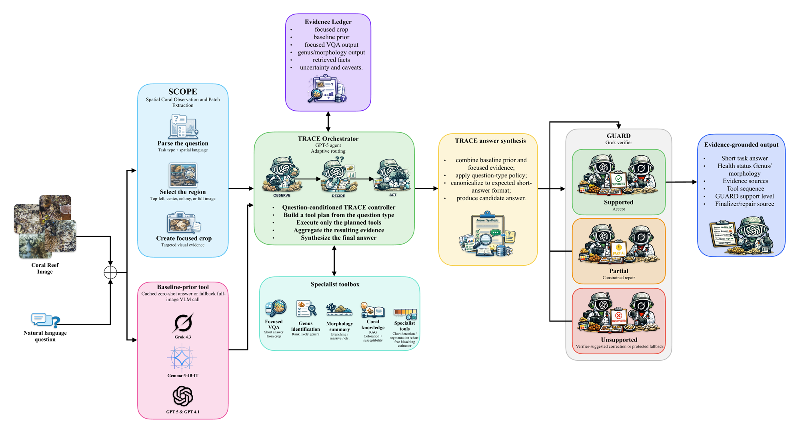
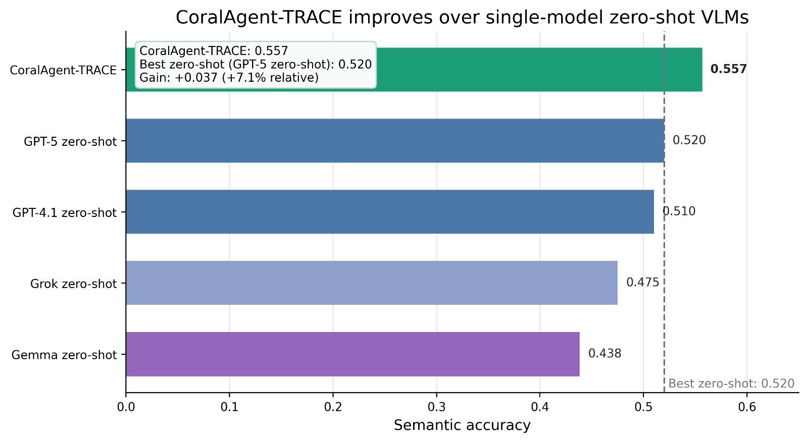
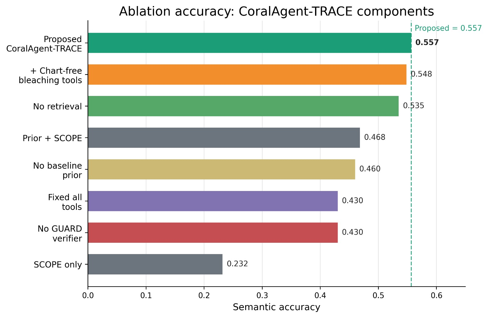

# CoralAgent-TRACE

**An evidence-grounded agentic framework for coral reef health assessment and visual question answering.**

CoralAgent-TRACE answers questions about coral reef images (health status, bleaching, genus, morphology, color, presence and coverage) by planning a short, question-specific sequence of tools instead of asking a single vision-language model to answer from the whole image. Every answer comes with the evidence that produced it and is checked by an independent verifier before it is returned.

> **Paper:** M. Al Juboori, M. Ur Rehman and Z. Abbas, "CoralAgent-TRACE: An Evidence-Grounded Agentic Framework for Coral Reef Health Assessment and Visual Question Answering," *Frontiers in Marine Science* (Coral Reef Research), under review, 2026.



## How it works

1. **SCOPE** (Spatial Coral Observation and Patch Extraction) parses the question's spatial language and crops the region it refers to: a quadrant, the central colony, or the full image.
2. A **baseline-prior tool** supplies a cached zero-shot answer from a full-image VLM. It is treated as one piece of evidence, never as ground truth.
3. The **TRACE orchestrator** (GPT-5) builds a tool plan from the question type and runs only the planned tools: focused VQA on the crop, genus identification, morphology summary, and retrieval from a curated coral knowledge base.
4. **TRACE answer synthesis** combines the baseline prior with the focused evidence and canonicalizes the result to CoralVQA's short-answer format.
5. **GUARD** (Grok-4.3) independently verifies the candidate answer against the evidence. Supported answers are accepted, partially supported ones go through a constrained repair, and unsupported ones fall back to a verifier-suggested correction.

Routing is question-conditioned and planned, not multi-agent debate and not a learned free-form tool policy.

## Results

Development experiment on **CoralVQA**: 100 images × 6 questions (600 question–answer pairs), semantic accuracy.



| Method | Semantic accuracy |
|---|---:|
| **CoralAgent-TRACE** | **0.557** |
| GPT-5, strict zero-shot | 0.520 |
| GPT-4.1, zero-shot | 0.510 |
| Grok, zero-shot | 0.475 |
| Gemma, zero-shot | 0.438 |

CoralAgent-TRACE improves on the strongest single model by **+3.7 points** (7.1% relative).

**Ablations** show that each component contributes:

| Variant | Semantic accuracy |
|---|---:|
| Full method (A3) | **0.557** |
| + chart detection, segmentation and bleaching proxy (A7) | 0.548 |
| No retrieval | 0.535 |
| Baseline prior + SCOPE only | 0.468 |
| No baseline prior | 0.460 |
| Fixed pipeline running every tool | 0.430 |
| No GUARD verifier | 0.430 |
| SCOPE only | 0.232 |

Running every tool on every question is worse than planning which tools to call. Removing the verifier costs 12.7 points.



**Scope of these results.** The first 100 images were inspected during development, so they are development and ablation evidence. The frozen policy was then extended to a persistent 500-image bank (images 101–500). Any further tuning after that extension would need a new untouched set, and the notebook includes a template for cross-region validation on PAC-USA.

## Repository contents

| Path | Contents |
|---|---|
| `CoralAgent_TRACE.ipynb` | The complete, executable pipeline: data loading, the 500-image bank, all tools, TRACE, GUARD, baselines, A0–A8 ablations, metrics, paired tests, figures and qualitative evidence traces |
| `requirements.txt` | Python dependencies |
| `.env.example` | The environment variables the notebook reads |
| `figures/` | Architecture and results figures |

## Running it

```bash
git clone https://github.com/mustafanfj/CoralAgent-TRACE.git
cd CoralAgent-TRACE
pip install -r requirements.txt
cp .env.example .env    # then fill in your keys; never commit this file
jupyter lab CoralAgent_TRACE.ipynb
```

API keys are read from environment variables, Kaggle Secrets, or a hidden prompt. They are never stored in the notebook.

Every model call is checkpointed, so an interrupted run resumes where it stopped. The notebook supports several run profiles, selected with `CORALAGENT_RUN_PROFILE`:

| Profile | Images | Purpose |
|---|---:|---|
| `development_100` | 100 | Reproduce the baselines and the A0–A8 ablation |
| `extension_A3_500` | 500 | Run the frozen method on the remaining bank images only |
| `analysis_only` | existing | Rebuild metrics, figures and audits with no API calls |
| `strict_gpt5_500` | 500 | Complete the strict GPT-5 comparator on all 500 images |
| `cross_region` | configurable | Template for untouched cross-region validation |

Keep `CORALAGENT_EXPERIMENT_TAG` unchanged when moving from 100 to 500 images so completed rows are reused.

**Models:** GPT-5 (orchestrator and tools), Grok-4.3 (GUARD verifier), with GPT-4.1, Grok and Gemma as zero-shot baselines. Providers: OpenAI, xAI and Together.ai.

**Data:** [CoralVQA](https://huggingface.co/datasets/CoralReefData/CoralVQA), labeled LLaVA-format split. The dataset is downloaded by the notebook and not redistributed here; please follow its license and citation terms.

## Citation

The paper is under review. A BibTeX entry will be added here on publication.

## Contact

Mustafa Al Juboori, Autonomous Systems Lab, College of Computing and AI, United Arab Emirates University. [mustafanfj@gmail.com](mailto:mustafanfj@gmail.com)
